<p align="center">
<a href="LICENSE"></a>
<a href="https://github.com/mpjanofsky/echo-wall-clock/releases/latest"></a>
<a href="https://mpjanofsky.github.io/echo-wall-clock/"></a>
</p>

# Echo Wall Clock, without the Echo



Reverse-engineered protocol and a small Python library for driving the **Amazon Echo Wall Clock**
from anything that speaks Bluetooth Classic: set the time, show timers on the LED ring, pulse for
timers/alarms/reminders, and light the notification LED. No Echo required. It runs locally and never
touches Amazon's servers.

**[Try the clock simulator](https://mpjanofsky.github.io/echo-wall-clock/)** in your browser.

## Tested hardware

| Thing | Version |
|---|---|
| Echo Wall Clock | FCC ID UUU-8459, firmware `102` |
| Controller | Raspberry Pi 3B, Raspberry Pi OS, BlueZ 5.82, Wi-Fi off |
| Reference Echo | Echo Dot, 3rd gen (model C78MP8), used only to capture real Echo traffic |

Other firmware versions are untested; see [CONTRIBUTING.md](CONTRIBUTING.md).

- [`PROTOCOL.md`](PROTOCOL.md): pairing quirks, framing, messages, and observed display behavior.
- [`agt.py`](agt.py): transport-independent framing, checksum, protobuf codec and message builders.
- [`pi_echo.py`](pi_echo.py): the Echo side on Linux/BlueZ (tested on a Raspberry Pi 3B). Pairs,
  handshakes, syncs time, starts and cancels timers; `--control FIFO` for interactive sessions.
- [`fake_clock.py`](fake_clock.py): the clock side on Linux/BlueZ, for capturing what a real Echo sends.
- [`clocksim.py`](clocksim.py): face simulator. Draws the 60-LED ring and hands as SVG from a list of
  timers (idle, one, several, paused, done); stdlib only. `python3 clocksim.py --out docs/sim` writes
  the example scenes, and `render_svg()` can be called on every timer change for a live preview.
- [`web/`](web): interactive simulator page ([try it live](https://mpjanofsky.github.io/echo-wall-clock/)) and a JS port of the renderer
  (`clocksim.js`); `python3 tests/test_parity.py` checks it matches `clocksim.py`. To run it locally,
  serve the folder (`python3 -m http.server -d web`).
- [`examples/set_timer.py`](examples/set_timer.py): smallest use of `agt.py`; builds the frames, no Bluetooth needed.
- [`tools/`](tools): `extract_response.py`, plus early macOS recon scripts in `tools/macos/`.
  [`scripts/`](scripts): Pi helper scripts (install dir is `$CLOCK_DIR`, default `~/clock`).
- [`docs/`](docs): [quick start](docs/quickstart.md), [troubleshooting](docs/troubleshooting.md),
  [controller mapping](docs/controller-mapping.md) (timer events to messages),
  [capturing your own](docs/capture-your-own.md).

```bash
# clock flashing amber (hold its button); run as root on the Pi, with Wi-Fi off on a Pi 3
sudo python3 pi_echo.py --address CC:9E:A2:xx:xx:xx --fresh --timer 3 --listen 200
```

Requires `python3-dbus` and `python3-gi`. Writing to the clock's OTA channel (RFCOMM 2) is never
needed and not supported.

## Disclaimer

Unofficial, not affiliated with or endorsed by Amazon. Alexa and Echo are Amazon trademarks. The
code was written from observed behavior and Amazon's public protocol documentation; no Amazon sample
code is included. Use at your own risk; this talks to your own device only. Do not publish your
clock's serial number or device token (they appear in its `Discover.Response`).

Code is Apache-2.0 (see [LICENSE](LICENSE) and [NOTICE](NOTICE)).
